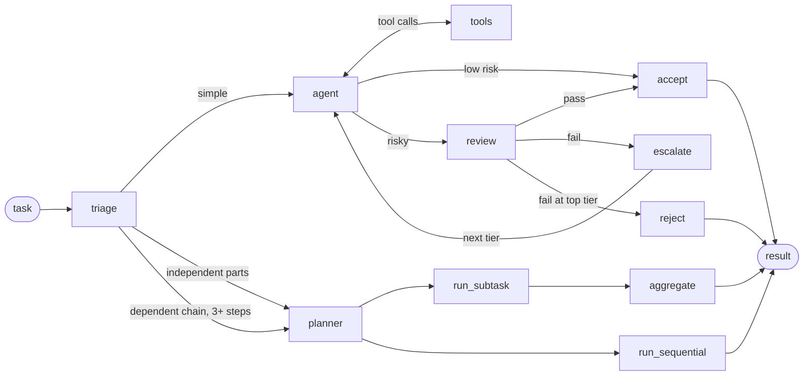

# Cost-Cascade Agent

A LangGraph agent that starts every task on the cheapest model available and pays for
decomposition, review or a stronger model only when the task actually needs it.

Most agent setups pick one model and use it for everything. This one treats model choice as
a routing problem: a triage step decides how risky and how multi-step a task is, a cheap tier
does the work, an optional reviewer checks it, and a failed review escalates to the next tier
instead of failing the run. Around that core sit a deterministic eval harness, a sandboxed
self-improvement loop that may only merge changes that beat the baseline, and an MCP server
so other agents can hand tasks to it.

## How it works



- **Triage** classifies the task with a structured-output call: risk level, whether review is
  needed, how many distinct actions it asks for, and whether those actions depend on each
  other. Optionally, [TypeSafe Jev](https://docs.typesafe.ai) answers the same questions as
  fixed typed choices with probabilities, so the same task gets the same routing every time.
  Anything below the confidence threshold, and any API error, falls back to the LLM triage.
- **Split** runs independent deliverables as parallel subtasks. A dependent chain of three or
  more steps runs as an ordered pipeline where each step sees the earlier results.
- **Execute** runs a tool-calling loop on the current tier (`low → mid → high → local`).
- **Review** runs only when triage flagged the task as risky. A failed review sends the
  feedback back to the agent on the next tier up. `local` is an Ollama model with no
  external quota, so the system can always make progress when every cloud pool is exhausted.
- **Infra fallback** is separate from quality escalation. Rate limits are waited out on the
  same tier, and a provider pool that is down moves the call up a tier without counting as an
  attempt.

Model tiers are combos on an OmniRoute gateway,
an OpenAI-compatible router over many providers. The gateway handles provider failover
inside a tier, and this graph handles the cross-tier cascade, which a gateway's routing
strategies can't express.

## Tools

| Tool | Notes |
|---|---|
| `file_read`, `file_write`, `list_directory` | Sandboxed to `AGENT_WORKSPACE_DIR`; paths outside it are refused |
| `calculator` | AST-based, no `eval` |
| `code_execution` | Python in a subprocess with a timeout, run from the workspace. Not a hardened sandbox: it has this process's filesystem and network access |
| `web_search` | DuckDuckGo; failures come back as a tool result instead of crashing the run |
| `browser_open`, `browser_act`, `browser_text` | Headless Chromium via Playwright. `browser_act` takes a plain-language instruction, and the LLM (or Jev, opt-in) picks the element |

## Evaluation

`eval_fixtures/` holds assertion-based test cases rather than judged outputs. Each fixture
states what a correct run must produce: substrings in the answer, files with specific content
in the workspace, a required tool call, or an attempt budget. File assertions are checked
against the workspace itself, not against the model's description of what it did.

```bash
# run a suite against a source tree in an offline container (the runner does this for you)
python -m tools.eval_agent run --image <image> --source-dir <tree> --pattern "fast_*.json" --out results.json

# baseline vs candidate for one metric; exits 0 on pass, 1 on fail
python -m tools.eval_agent compare --baseline base.json --candidate cand.json --metric success_rate

# LLM triage vs Jev triage, on the host (needs network)
python -m tools.compare_triage_backends --repeats 2
```

`compare_triage_backends` reports pass rate, escalation rate, latency, and **triage
consistency**: whether repeated runs of the same fixture made the same routing decision.

## Self-improvement loop

`tools/self_improvement_runner.py` is an hourly supervisor that lets the agent propose a
change to itself and accepts it only if the numbers say so:

1. The agent runs once, as an *authoring* step, in a Docker container with
   `--network none` and a disposable clone of the repo. It writes a hypothesis (a code change
   or a model-combo change, the target metric, and a guard metric that must not regress).
2. Baseline and candidate are evaluated on the same fixtures in separate offline containers.
3. Plain Python, never an LLM, decides pass or fail from the measured scores. Only a passing
   candidate is merged. Every cycle is appended to `state/improvement_history.json` and gets a
   report in `reports/`.

The containers never hold a real API key. They reach models only through
`tools/omniroute_broker.py`, a host process that holds the key, allows only
inference-shaped requests, and enforces a per-role call budget.

So far the gate has done its job mostly by saying no: across 59 recorded cycles, 1 passed.
Most failures are real (the candidate didn't beat the baseline) or infrastructure problems
caught before any hypothesis was scored. The commit history shows the prompt and pipeline
changes that came out of reading those failures.

## MCP server

`agent/server.py` exposes the graph to other agents over streamable HTTP, with bearer-token
auth:

- `submit_task(task, notify=False)` queues a task and returns a job id immediately
- `get_task_result(job_id)` returns the status and, once done, the output and trace
- `list_tasks(limit=20)` returns recent jobs

Jobs are persisted under `state/jobs/`. A job that was running when the server stopped is
marked `interrupted` on restart. With `notify=true`, a completion email goes to the fixed
address in `NOTIFY_EMAIL_TO`, so the caller can't choose the recipient.

## Setup

Requires Python 3.11+ and a running OmniRoute instance with four combos for the tiers.

```bash
python -m venv .venv
source .venv/bin/activate
pip install -r requirements.txt
playwright install chromium   # only needed for the browser tools
cp .env.example .env          # then fill in the gateway URL, key and tier combo names
```

Run a single task:

```bash
python -m agent.main "Write a file called primes.txt with the first 20 prime numbers"
```

The output ends with a trace of the routing decisions: split mode, risk level, final tier,
number of attempts, and the review result.

Start the MCP server (set `AGENT_SERVER_TOKEN` first; because `code_execution` is not
sandboxed, only expose the server to callers you trust):

```bash
python -m agent.server
```

Run the tests:

```bash
python -m pytest -q
```

## Configuration

All settings come from `.env`; see [.env.example](.env.example) for the full list.

| Variable | Default | Purpose |
|---|---|---|
| `LOW_MODEL` / `MID_MODEL` / `HIGH_MODEL` / `LOCAL_MODEL` | `alper-*` | OmniRoute combo for each tier |
| `MAX_ATTEMPTS` | `4` | Review-driven attempts before rejecting |
| `AGENT_MIN_TIER` / `AGENT_MAX_TIER` | `low` / `local` | Clamp where the cascade starts and stops |
| `TRIAGE_BACKEND` | `auto` | `auto` uses Jev when `TYPESAFE_API_KEY` is set; `llm` never does |
| `JEV_CONFIDENCE` | `0.7` | Minimum Jev probability before its answer is used |
| `AGENT_REQUIRED_OUTPUT` | | File that must exist in the workspace before a task can be accepted |
| `BROWSER_ENABLED` / `BROWSER_DECISIONS` | `true` / `llm` | Browser tools on/off, and who picks elements |
| `AGENT_SERVER_TOKEN` | | Required to start the MCP server |
| `LANGSMITH_TRACING` | `false` | Send traces to LangSmith |

## Layout

```
agent/            graph, nodes, tiers, tools, Jev triage, browser, MCP server, job store
tools/            eval harness, self-improvement runner, broker, git helpers, triage comparison
eval_fixtures/    assertion-based test cases (fast_* and full_* suites)
prompts/          authoring prompt for the self-improvement loop
reports/          one report per self-improvement cycle
state/            improvement history and its JSON schema
tests/            unit tests
```
